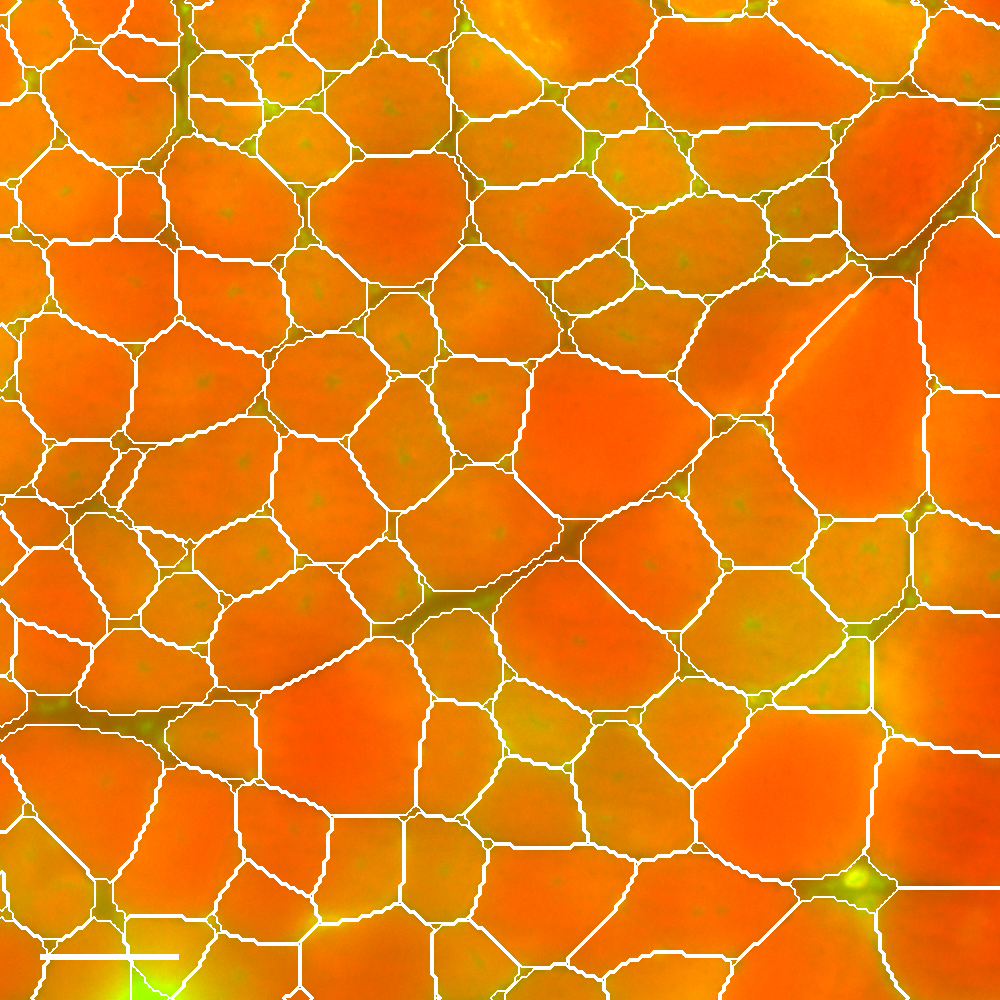
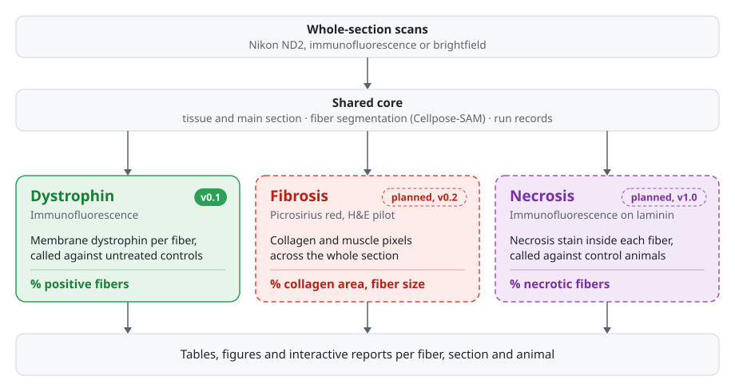
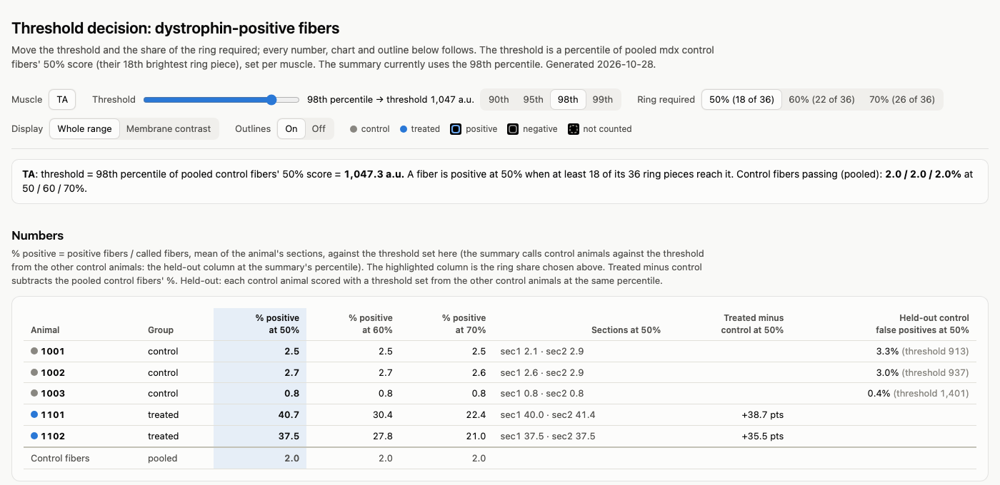
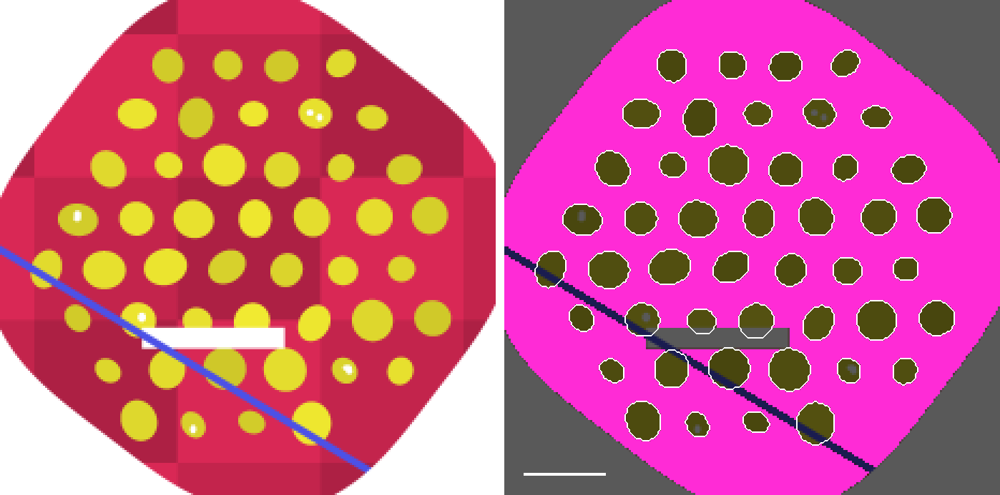
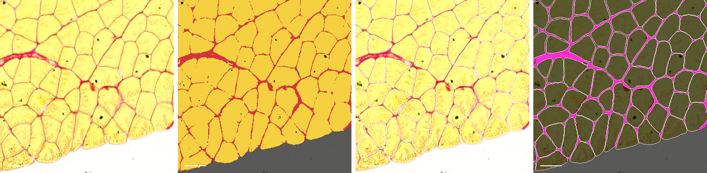
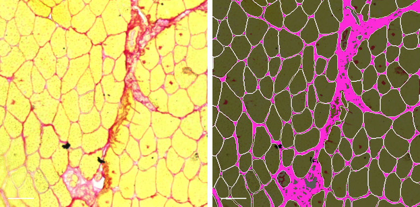
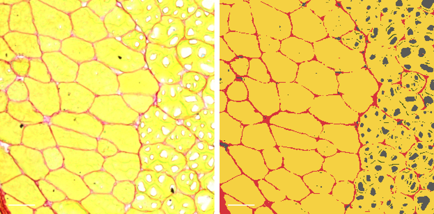

# muscle-section-quant

Quantifies whole-section scans of mouse muscle cross-sections, one assay per stain. The dystrophin assay measures dystrophin in every fiber and calls each fiber positive or negative; the share of positive fibers is the usual readout when a treatment aims to bring dystrophin back to the fiber membrane. The picrosirius red (PSR) assay measures collagen outside the fiber outlines. Input is a whole-section Nikon ND2 scan; output is tables per fiber, section and animal, figures, and for dystrophin interactive reports.

[](https://github.com/foertsch/muscle-section-quant/actions/workflows/tests.yml) [](LICENSE)

**Status:** v0.2, two assays (dystrophin, PSR fibrosis). Research software written for one lab's experiments. The dystrophin call rule has not yet been tested on an independent dataset, and the PSR readout depends on the fiber outlines; see [Status and limits](#status-and-limits).



*Crop from one of the lab's mouse muscle sections, about 360 µm wide: actin (red), dystrophin (green) and the fiber outlines Cellpose-SAM found on actin (white). Scale bar 50 µm.*

## What it does

Dystrophin: for each section it outlines every fiber and measures dystrophin along the fiber's edge. Untreated control animals scanned in the same run set the threshold: a fiber is positive when at least half of its edge is as bright as only 2% of control fibers are. Results come per fiber and are summarised per section and per animal.

Scoring dystrophin per fiber is a standard measurement. This package does it on whole sections, every fiber, with Cellpose-SAM (a recent deep-learning segmentation model) finding the fibers. Its shared Python core is built so that another stain or assay is one more module; PSR is the second.

<picture>
  <source media="(prefers-color-scheme: dark)" srcset="docs/images/overview-dark.svg">
  
</picture>

Dystrophin is the first assay and picrosirius red fibrosis the second (v0.2). Necrotic fibers on laminin are planned for v1.0, on the same shared core (`msq.core`).

- **Input, dystrophin:** whole-section immunofluorescence scans (Nikon ND2, 20x) with an actin channel (Cy5) and a dystrophin channel (GFP), and untreated control animals of the same muscle in the same run.
- **Output, dystrophin:** for every fiber its size, its dystrophin signal and its call at 50, 60 and 70% of the ring; per section and per animal the share of positive fibers; two kinds of interactive HTML report; a record of the package versions behind the run, and of the code and Cellpose weights behind every section.

## Try it without data

Needs [uv](https://docs.astral.sh/uv/).

```bash
git clone https://github.com/foertsch/muscle-section-quant.git
cd muscle-section-quant
uv sync
uv run python demo/run_demo.py
```

The demo builds ten synthetic sections (three control and two treated animals, two sections each), runs the whole pipeline on them in about a minute and writes the results to `demo/output/run/`. It uses each synthetic section's known outlines, so it needs no model; `--cellpose` segments with Cellpose-SAM instead. Open `reports/threshold_decision.html` to move the threshold and watch the calls change:



*The demo's threshold report, on synthetic data.*

The PSR demo needs no data either:

```bash
uv run python demo/run_psr_demo.py
```

It builds eight synthetic picrosirius red sections (a control group and a treated group with more collagen between smaller fibers, two animals per group, two sections each) and measures them with the sections' own outlines, so it needs no model. It takes about a minute and writes `demo/output/psr/`: `tables/` (`sections.csv`, `animals.csv`, `genotypes.csv`, `fibers.csv.gz`), `run/sections/base/` (one folder per section) and, if `Rscript` is on the path, the R figures in `figures/` (see the R packages below). `--no-r` skips the figures and `--out` sets another folder.



*Crop from the synthetic demo section QUAD_sec1_B01_group_a, 300 µm wide, drawn with `demo/make_crops.py`. Left: the colour image divided by the glass colour. Right: red-class pixels in the main section outside every fiber outline (magenta), with the outlines in white; grey lies outside the main section. Synthetic data, not a real section.*

<details>
<summary>Platform notes</summary>

`uv sync` installs Python 3.13 and the pinned packages into `.venv/`. On a Mac the GPU is used through MPS. On Windows, `uv sync` installs PyTorch's CUDA 13.0 build, which needs an NVIDIA driver 580 or newer. Cellpose-SAM downloads its weights (about 1.2 GB) the first time it segments, on real scans or with `--cellpose`.

</details>

## Run it on your scans

### Dystrophin

```bash
uv run msq-dystrophin "path/to/scans" "path/to/run folder"
```

Every 20x `.nd2` file below the scan folder becomes one section. Muscle (`QUAD` or `TA`), section, animal and magnification come from the file name, for example `0001 1001 L TA sec 2 20x.nd2` (the animal is a 4-digit number from 1000 to 1999). Scans in a folder whose name starts with `Neg-ctrl` are untreated controls; all others are treated. The sample table this builds (`samples.csv` in the run folder) can be corrected by hand. The scans are checked before anything slow starts (channels, pixel size, imaging settings within a muscle, controls present); `--check-only` stops there. A stopped run resumes where it left off.

`uv run msq-dystrophin-app` does the same from a browser page on this computer (127.0.0.1 only): pick the scan folder, review the sample table, start, follow the progress, open the results.

The run folder holds `tables/` (per animal, per section, every fiber's score and call, the thresholds), `figures/`, the interactive reports in `reports/` (the threshold decision, and one control-versus-treated report per muscle), and a record of the code version, package versions and Cellpose weights.

### PSR

```bash
uv run msq-psr "path/to/scans" "path/to/run folder" --cohort NAME
```

Every whole-section 20x brightfield `.nd2` scan below the scan folder (`full` in the file name; single fields are left out) becomes one section. Group, animal, section and muscle come from the folder and file names, as the cohort says. Copy `cohorts.example.toml` to `cohorts.local.toml` and write your own cohort in it: the folder names of the groups, their order, the control, display names and colours, and a pattern for the animal number (the file explains each key and shows two naming schemes; `--cohort example` uses the generic groups). The muscle name `QUAD` must be in the name of the scan's own folder or in its file name. As for dystrophin, the scans are checked first (`--check-only` stops there, after writing `samples.csv` and `checks.txt`) and a stopped run resumes. `--variants` runs other segmentation inputs for comparison; the tables use the first. Fibers are segmented with Cellpose-SAM, as for dystrophin.

The run folder holds `sections/base/<sample>/` per section and `tables/`: `sections.csv`, `animals.csv`, `genotypes.csv`, `fibers.csv.gz` (every fiber that passes the fiber rule), `palette.csv` and two Python figures.

The figures and statistics are drawn in R from `tables/`:

```bash
Rscript R/figures.R psr "path/to/run folder/tables" "path/to/figures"
Rscript R/export.R psr "path/to/run folder/tables" "path/to/values"
```

`figures.R` writes each figure as `.pdf` and `.png` (collagen outside the fiber outlines, fiber count, fiber density, each by genotype and by animal, plus fiber size distributions) and `stats_vs_control.csv`. `export.R` writes the numbers behind every figure as CSV, for replotting elsewhere. R packages: testthat (tests only), ggplot2, dplyr, readr, multcomp, tidyr and ragg.

Sections with freezing artifacts are marked in the R figures only when `sections.csv` has a `freezing_artifact_area` column. `msq.psr.summary --holes` adds it from a CSV with one row per section (`sample`, `holey_area`) built from the hole survey (`hole_survey.py`, one JSON per scan). `msq-psr` does not run the survey or build that CSV, so a plain run marks nothing; the demo does both.

## How a fiber is called

[Cellpose-SAM](https://github.com/MouseLand/cellpose) outlines each fiber on the actin channel. Dystrophin is read in a thin band along the outline (±1.5 µm), split into 36 ring pieces, and each piece is compared with the fiber's own cytoplasm. A fiber is positive at 50% when at least half of its measured pieces reach the threshold (18 of 36 when all are measured); the stricter levels ask for 60 and 70% of the ring against the same threshold.


*One fiber, cropped from one muscle section. Left: its outline (white) and the cytoplasm core its ring is compared with (amber). Right: the ±1.5 µm band in 36 ring pieces, each coloured by its brightness above the cytoplasm (lighter = brighter). Scale bar 10 µm.*

The threshold is set per muscle on the pooled control fibers: the 98th percentile of their 50% scores, so about 2% of control fibers pass. Each control animal is called against a threshold set on the other control animals, so its result is what an unseen control would give. Method: [docs/METHOD_dystrophin.md](docs/METHOD_dystrophin.md); terms: [docs/GLOSSARY.md](docs/GLOSSARY.md).

## Picrosirius red fibrosis

The scan is divided by the colour of the empty glass, so scans taken with different exposure or white balance become comparable (this assumes the camera responds linearly to light). Each pixel then falls into one of four classes by hue and saturation, with the rule of [Hildyard et al.](https://doi.org/10.17504/protocols.io.81wgb6j1olpk/v1) (protocols.io): background, red (collagen), yellow (fiber) or other. [Cellpose-SAM](https://github.com/MouseLand/cellpose) outlines the fibers on a signal made from the green and red channels.

The primary readout is **collagen outside the fiber outlines**: the red area in the main section outside every outline, as a share of the red plus yellow area of the main section. It comes per section and per animal (the mean of its sections). The share of all red, inside or outside outlines (`red_fraction`, the fibrosis fraction of Hildyard et al.), is in the tables as a secondary readout and is not plotted. Fiber size (minimum and maximum Feret diameter, area) and fiber count and density per section come from the same outlines; count and density are exploratory.



*Crop from one of the lab's mouse muscle sections, 400 µm wide, from left to right: the colour image divided by the glass colour; the pixel classes (red collagen, yellow fiber, the rest dimmed); the Cellpose-SAM outlines (white); the red pixels outside every outline (magenta), whose share of all red plus yellow is the primary readout. Grey at the bottom is glass outside the main section. Scale bar 50 µm.*



*Crop from one of the lab's mouse muscle sections, 400 µm wide. A septum of perimysium with a small vessel runs through the fibers; all of its red lies outside the outlines and counts towards the readout (right, magenta). Scale bar 50 µm.*



*Crop from one of the lab's mouse muscle sections, 400 µm wide. The fibers on the right are full of freezing-artifact holes; the holes are unstained and drop out of both red and yellow (right, dimmed), while the outlines still follow the fibers. Scale bar 50 µm.*

Method: [docs/METHOD_psr.md](docs/METHOD_psr.md); terms: [docs/GLOSSARY.md](docs/GLOSSARY.md).

## Status and limits

This is research software, written for one lab's experiments.

Dystrophin:

- The call rule and its threshold were chosen on the first dataset analysed with this tool, with its results visible, and have not yet been tested on an independent dataset.
- There is no positive control, so the sensitivity of the call (how many truly positive fibers it misses) is unknown.
- At 20x, membrane signal from a neighbouring fiber can raise a fiber's ring score and so push it over the threshold.
- Control animals are reported by leave-one-animal-out values. A muscle with a single control animal has no such value; that animal is called against its own threshold and marked.
- Input is Nikon ND2 only, and the sample table is built from the lab's file naming (it can be corrected by hand).
- Tested on a Mac (Apple GPU through MPS). The Windows and CUDA setup is configured in `pyproject.toml` but untested: CI runs on Linux, and the unit tests only cover the Windows path handling.

Picrosirius red:

- Collagen outside the fiber outlines is the red area in the main section outside every Cellpose-SAM outline, as a share of red plus yellow. Perimysium, epimysium, tendon and vessel walls count. Red inside any outline does not, including outlines of objects that are not fibers, so the readout depends on the outlines.
- Only the largest piece of tissue on the slide is measured; neighbouring sections and torn fragments are left out.
- Dividing by the glass colour assumes the camera responds linearly. This was checked on synthetic images only. If scans of different groups differ in brightness, a remaining effect would sit on the group contrast.
- Folds, dust, edge staining and tendon are not masked. Sections with much freezing artifact are marked in the figures when the hole survey table is passed to `msq.psr.summary` (the mark uses a threshold of 0.3 chosen on the lab's sections); none is excluded.
- Each group is compared with control by Dunnett's test on animal means, with no ANOVA first. Collagen outside the fiber outlines is the primary readout; fiber count and density are exploratory. The animal is the unit; with two animals per group, as in the demo, the test has little to work with.
- The outlines were checked by eye on a review page, by one reviewer. There is no accuracy figure for them.
- Input is Nikon ND2 only, 20x whole-section scans of `QUAD` muscle; the sample table is built from folder and file names as the cohort describes.

Both assays:

- Cellpose's code is BSD-3-licensed; its models are trained on data licensed CC-BY-NC (see the [Cellpose README](https://github.com/MouseLand/cellpose)), which matters for commercial use. This applies to the dystrophin and the PSR assay alike.
- What the tests cover: unit tests, synthetic golden runs for both assays (`uv run pytest`), the R tests and both demos run in CI; the golden runs compare every table with the pipeline's own earlier output. Checks on the lab's real scans are run privately and are not part of this repository.

## Development

`uv run pytest` runs the unit tests and the synthetic golden runs; the R tests are included when `Rscript` and the packages above are installed, and skipped otherwise. `demo/make_crops.py` draws images like the ones above from a finished run: copy `demo/crops.example.toml` to `demo/crops.local.toml`, name the run folder and the section, and run `uv run python demo/make_crops.py demo/crops.local.toml`. For a PSR run set `assay = "psr"` (the file shows the block; on the synthetic demo use `window_um = 300`). Until v1.0, `msq.core` may still change between releases.

## How it was built

Developed with AI coding assistance (Claude Code); design, method choices and review by the author.

## Author and contact

Arion Förtsch, RMB Lab, ETH Zurich. Questions and bug reports: [GitHub issues](https://github.com/foertsch/muscle-section-quant/issues).

## License and citation

MIT, see [LICENSE](LICENSE). To cite this software, use [CITATION.cff](CITATION.cff) (GitHub's "Cite this repository").
