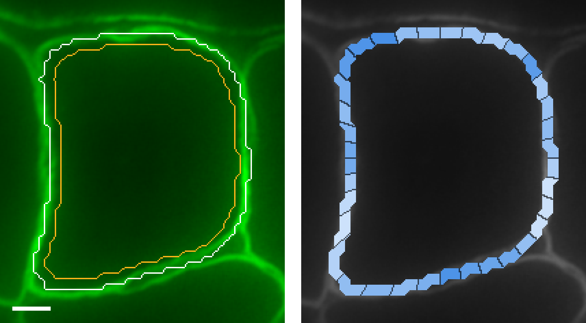

# muscle-section-quant

Measures dystrophin in every fiber of a mouse muscle cross-section and calls each fiber positive or negative. The share of positive fibers is the usual readout when a treatment aims to bring dystrophin back to the fiber membrane. Input is a whole-section Nikon ND2 scan; output is per-fiber and per-animal tables plus interactive reports of two kinds.

[](https://github.com/foertsch/muscle-section-quant/actions/workflows/tests.yml) [](LICENSE)

**Status:** v0.1, one assay (dystrophin). Research software written for one lab's experiments. The call rule has not yet been tested on an independent dataset; see [Status and limits](#status-and-limits).


*Crop from one of the lab's mouse muscle sections, about 360 µm wide: actin (red), dystrophin (green) and the fiber outlines Cellpose-SAM found on actin (white). Scale bar 50 µm.*

## What it does

For each section it outlines every fiber and measures dystrophin along the fiber's edge. Untreated control animals scanned in the same run set the threshold: a fiber is positive when at least half of its edge is as bright as only 2% of control fibers are. Results come per fiber and are summarised per section and per animal.

Scoring dystrophin per fiber is a standard measurement. This package does it on whole sections, every fiber, with Cellpose-SAM (a recent deep-learning segmentation model) finding the fibers. Its shared Python core is built so that another stain or assay is one more module.

<picture>
  <source media="(prefers-color-scheme: dark)" srcset="docs/images/overview-dark.svg">
  
</picture>

Dystrophin is the first assay. Picrosirius red fibrosis (with an H&E pilot) and necrotic fibers on laminin follow in v0.2 and v1.0, on the same shared core (`msq.core`).

- **Input:** whole-section immunofluorescence scans (Nikon ND2, 20x) with an actin channel (Cy5) and a dystrophin channel (GFP), and untreated control animals of the same muscle in the same run.
- **Output:** for every fiber its size, its dystrophin signal and its call at 50, 60 and 70% of the ring; per section and per animal the share of positive fibers; two kinds of interactive HTML report; a record of the package versions behind the run, and of the code and Cellpose weights behind every section.

## Try it without data

Needs [uv](https://docs.astral.sh/uv/).

```bash
git clone https://github.com/foertsch/muscle-section-quant.git
cd muscle-section-quant
uv sync
uv run python demo/run_demo.py
```

The demo builds ten synthetic sections (three control and two treated animals, two sections each), runs the whole pipeline on them in about a minute and writes the results to `demo/output/run/`. It uses each synthetic section's known outlines, so it needs no model; `--cellpose` segments with Cellpose-SAM instead. Open `reports/threshold_decision.html` to move the threshold and watch the calls change:


*The demo's threshold report, on synthetic data.*

<details>
<summary>Platform notes</summary>

`uv sync` installs Python 3.13 and the pinned packages into `.venv/`. On a Mac the GPU is used through MPS. On Windows, `uv sync` installs PyTorch's CUDA 13.0 build, which needs an NVIDIA driver 580 or newer. Cellpose-SAM downloads its weights (about 1.2 GB) the first time it segments, on real scans or with `--cellpose`.

</details>

## Run it on your scans

```bash
uv run msq-dystrophin "path/to/scans" "path/to/run folder"
```

Every 20x `.nd2` file below the scan folder becomes one section. Muscle (`QUAD` or `TA`), section, animal and magnification come from the file name, for example `0001 1001 L TA sec 2 20x.nd2` (the animal is a 4-digit number from 1000 to 1999). Scans in a folder whose name starts with `Neg-ctrl` are untreated controls; all others are treated. The sample table this builds (`samples.csv` in the run folder) can be corrected by hand. The scans are checked before anything slow starts (channels, pixel size, imaging settings within a muscle, controls present); `--check-only` stops there. A stopped run resumes where it left off.

`uv run msq-dystrophin-app` does the same from a browser page on this computer (127.0.0.1 only): pick the scan folder, review the sample table, start, follow the progress, open the results.

The run folder holds `tables/` (per animal, per section, every fiber's score and call, the thresholds), `figures/`, the interactive reports in `reports/` (the threshold decision, and one control-versus-treated report per muscle), and a record of the code version, package versions and Cellpose weights.

## How a fiber is called

[Cellpose-SAM](https://github.com/MouseLand/cellpose) outlines each fiber on the actin channel. Dystrophin is read in a thin band along the outline (±1.5 µm), split into 36 ring pieces, and each piece is compared with the fiber's own cytoplasm. A fiber is positive at 50% when at least half of its measured pieces reach the threshold (18 of 36 when all are measured); the stricter levels ask for 60 and 70% of the ring against the same threshold.



*One fiber, cropped from one muscle section. Left: its outline (white) and the cytoplasm core its ring is compared with (amber). Right: the ±1.5 µm band in 36 ring pieces, each coloured by its brightness above the cytoplasm (lighter = brighter). Scale bar 10 µm.*

The threshold is set per muscle on the pooled control fibers: the 98th percentile of their 50% scores, so about 2% of control fibers pass. Each control animal is called against a threshold set on the other control animals, so its result is what an unseen control would give. Method: [docs/METHOD_dystrophin.md](docs/METHOD_dystrophin.md); terms: [docs/GLOSSARY.md](docs/GLOSSARY.md).

## Status and limits

This is research software, written for one lab's experiments.

- The call rule and its threshold were chosen on the first dataset analysed with this tool, with its results visible, and have not yet been tested on an independent dataset.
- There is no positive control, so the sensitivity of the call (how many truly positive fibers it misses) is unknown.
- At 20x, membrane signal from a neighbouring fiber can raise a fiber's ring score and so push it over the threshold.
- Control animals are reported by leave-one-animal-out values. A muscle with a single control animal has no such value; that animal is called against its own threshold and marked.
- Input is Nikon ND2 only, and the sample table is built from the lab's file naming (it can be corrected by hand).
- Tested on a Mac (Apple GPU through MPS). The Windows and CUDA setup is configured in `pyproject.toml` but untested: CI runs on Linux, and the unit tests only cover the Windows path handling.
- Cellpose's code is BSD-3-licensed; its models are trained on data licensed CC-BY-NC (see the [Cellpose README](https://github.com/MouseLand/cellpose)), which matters for commercial use.
- What the tests cover: unit tests and a synthetic golden run (`uv run pytest`), run in CI together with the demo; the golden run compares every table with the pipeline's own earlier output. Checks on the lab's real scans are run privately and are not part of this repository.

## Development

`uv run pytest` runs the unit tests and the synthetic golden run. `demo/make_crops.py` draws images like the two above from a finished run: copy `demo/crops.example.toml` to `demo/crops.local.toml`, name the run folder and the section, and run `uv run python demo/make_crops.py demo/crops.local.toml`. Until v1.0, `msq.core` may still change between releases.

## How it was built

Developed with AI coding assistance (Claude Code); design, method choices and review by the author.

## Author and contact

Arion Förtsch, RMB Lab, ETH Zurich. Questions and bug reports: [GitHub issues](https://github.com/foertsch/muscle-section-quant/issues).

## License and citation

MIT, see [LICENSE](LICENSE). To cite this software, use [CITATION.cff](CITATION.cff) (GitHub's "Cite this repository").
